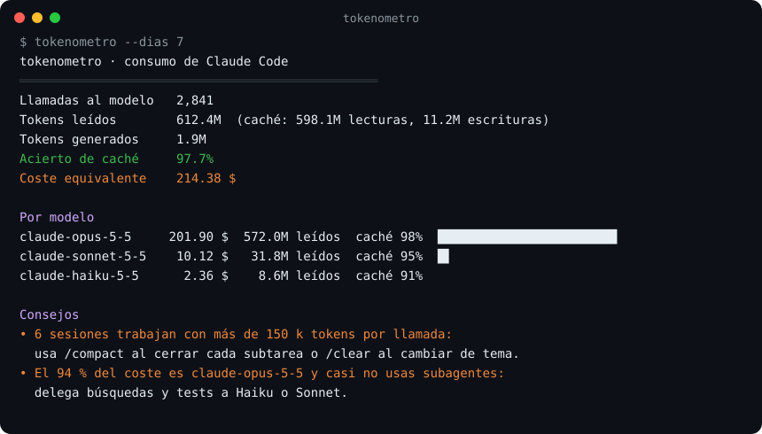

<div align="center">

# 💸 tokenómetro

**¿En qué se te van los tokens de Claude Code? Descúbrelo en 1 segundo y recibe consejos concretos para gastar menos.**




</div>

---

## Por qué

Los vídeos de "cómo ahorrar tokens en Claude Code" repiten los mismos trucos: `/compact`, `/clear`, CLAUDE.md corto, subagentes baratos… pero **no te dicen cuál te sirve a ti**. Esta herramienta lee tus propias sesiones y te lo dice con números.

- **Sin API key ni red**: solo lee los transcripts que Claude Code ya guarda en `~/.claude/projects`.
- **Cero dependencias**: Python estándar, un solo archivo.
- **Cuenta bien**: Claude Code escribe varias líneas por respuesta; el analizador deduplica por mensaje para no inflar el consumo.

## Uso

```bash
pipx install git+https://github.com/raulhernandezherce/tokenometro
tokenometro
```

O sin instalar nada:

```bash
git clone https://github.com/raulhernandezherce/tokenometro
python3 tokenometro/tokenometro/auditoria.py --dias 7
```

| Opción | Qué hace |
|---|---|
| `--dias N` | Periodo a analizar (por defecto 30; `0` = todo) |
| `--proyecto texto` | Solo los proyectos cuyo nombre contiene ese texto |
| `--top N` | Filas por tabla |
| `--json` | Salida JSON, para tus propios dashboards |
| `--precios archivo.json` | Tu propia tabla de precios |

### Como plugin de Claude Code

```
/plugin marketplace add raulhernandezherce/tokenometro
```

```
/plugin install tokenometro@tokenometro
```

Después pregunta *"¿cuánto he gastado esta semana?"* o *"¿por qué se me acaba el límite?"*: la skill `auditar-tokens` ejecuta el análisis y te explica qué cambiar.

## Qué mide

| Métrica | Para qué sirve |
|---|---|
| Tokens leídos / generados | Normalmente se lee **cientos de veces** más de lo que se genera: el coste está en el contexto |
| Acierto de caché | Por debajo del 90 % algo está rompiendo la caché |
| Contexto medio y máximo por sesión | Detecta sesiones que arrastran un historial enorme en cada llamada |
| Coste equivalente por API | Estimación con [`precios.json`](tokenometro/precios.json) (editable). Con Pro o Max no lo pagas así, pero sirve para comparar |
| Subagentes | Cuánto trabajo delegas a modelos más baratos |

Desglosado **por día, proyecto, modelo y sesión**.

## Los consejos

| Si detecta… | Te propone |
|---|---|
| Sesiones con más de 150 k tokens de contexto por llamada | `/compact` al cerrar cada subtarea, `/clear` al cambiar de tema |
| Acierto de caché < 80 % | No cambiar de modelo ni de esfuerzo a mitad de sesión; no editar CLAUDE.md con la sesión abierta |
| Muchas escrituras de caché frente a lecturas | Agrupar tareas en menos sesiones |
| > 90 % del coste en Opus/Fable y pocos subagentes | Delegar búsquedas y tests a Haiku o Sonnet |
| Ratio leído/generado muy alto | Recortar CLAUDE.md y desactivar servidores MCP que no uses |

## Desarrollo

```bash
python3 -m unittest discover -s tests -v
```

Combina bien con [claude-portero](https://github.com/raulhernandezherce/claude-portero), que elige el modelo adecuado para cada tarea antes de gastar.

---

<sub>Hecho por <a href="https://github.com/raulhernandezherce">Raúl Hernández Herce</a> · Licencia MIT · No afiliado a Anthropic</sub>
